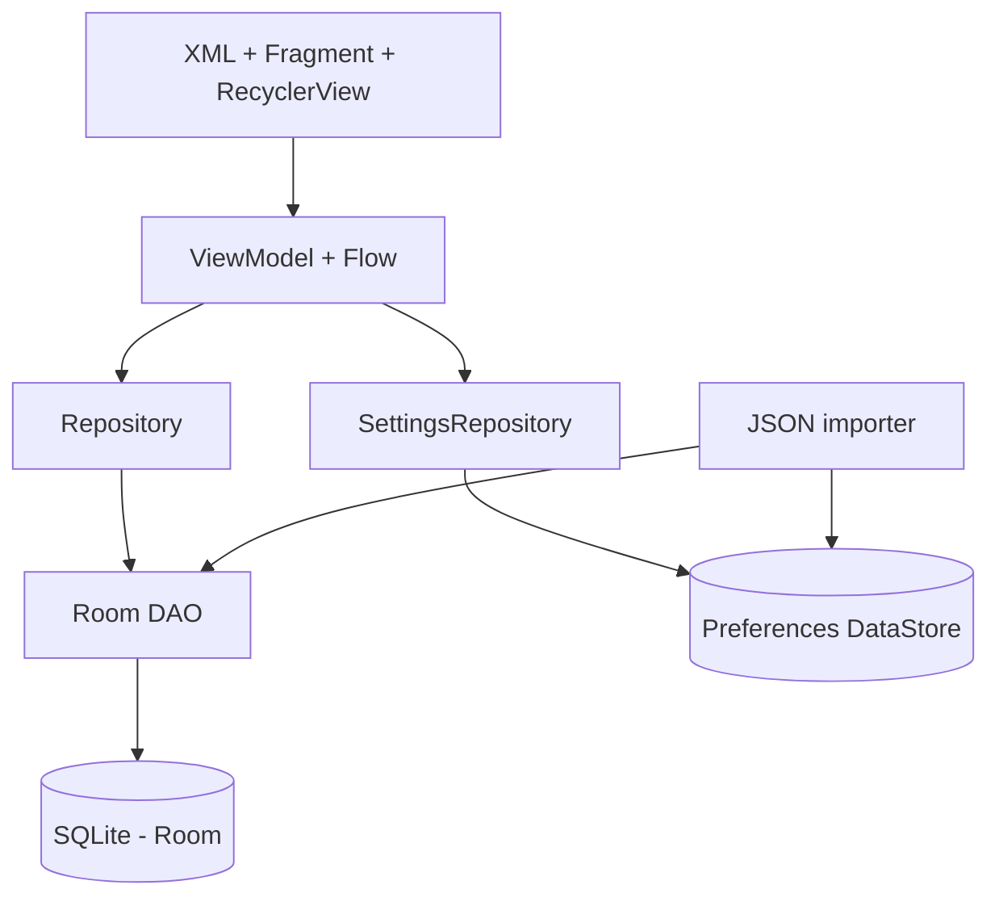

# FitJournal architecture



```mermaid
erDiagram
  EXERCISE ||--o{ WORKOUT_ENTRY : used_in
  WORKOUT ||--o{ WORKOUT_ENTRY : contains
  EXERCISE { long id PK; string code UK; string name; string category; string measurementType }
  WORKOUT { long id PK; string title; long sessionDate; boolean isCompleted }
  WORKOUT_ENTRY { long id PK; long workoutId FK; long exerciseId FK; int sets; int repetitions; double weightKg; long durationSeconds }
```

- Deleting a Workout cascades to its WorkoutEntry records.
- Deleting an Exercise referenced by entries is restricted. Catch this and show an understandable user message in Developer 1's UI.
- Seed exercises carry a unique `code`; import skips conflicts and never overwrites edits.
- The importer should run once per install; use the DataStore flag + a unique index and `IGNORE` for crash-safe retries.
- UI state should be collected with repeatOnLifecycle and survive rotation through ViewModels.
