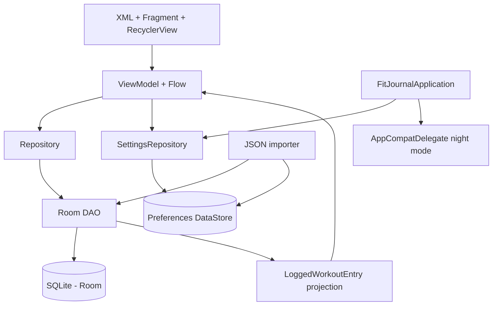

# FitJournal architecture



```mermaid
erDiagram
  EXERCISE ||--o{ WORKOUT_ENTRY : used_in
  WORKOUT ||--o{ WORKOUT_ENTRY : contains
  EXERCISE { long id PK; string code UK; string name; string category; string measurementType }
  WORKOUT { long id PK; string title; long sessionDate; boolean isCompleted }
  WORKOUT_ENTRY { long id PK; long workoutId FK; long exerciseId FK; int sets; int repetitions; double weightKg; long durationSeconds }
```

- Deleting a Workout cascades to its WorkoutEntry records.
- Deleting an Exercise referenced by entries is restricted. Catch this and show an understandable user message in Developer 1's UI.
- Seed exercises carry a unique `code`; import skips conflicts and never overwrites edits.
- The importer should run once per install; use the DataStore flag + a unique index and `IGNORE` for crash-safe retries.
- UI state should be collected with repeatOnLifecycle and survive rotation through ViewModels.
- Workout-entry drafts are stored in `SavedStateHandle`; weights cross the UI boundary in the selected unit but persist as kilograms.
- Progress combines live workout and joined-entry Flows. Counts, volume, charts, and personal records include completed workouts only.
- Strength volume is `sets × repetitions × weightKg`; duration entries are excluded. Personal records use maximum weight for strength and longest duration for timed exercises.
- Preferences: `dark_mode` (Boolean, absent = follow the device), `weight_unit` (`kg`/`lb`), and `exercise_sort` (`NAME_ASC`/`NAME_DESC`) live in Preferences DataStore. Setters validate values; unknown stored values fall back to defaults.
- `FitJournalApplication` reads the theme once before the first activity is created, then collects later changes and applies them with `AppCompatDelegate.setDefaultNightMode`. Activities recreate, and drafts survive through `SavedStateHandle`.
- The exercise catalogue combines its search text with the saved `exercise_sort` and re-queries the paged DAO whenever either changes.
