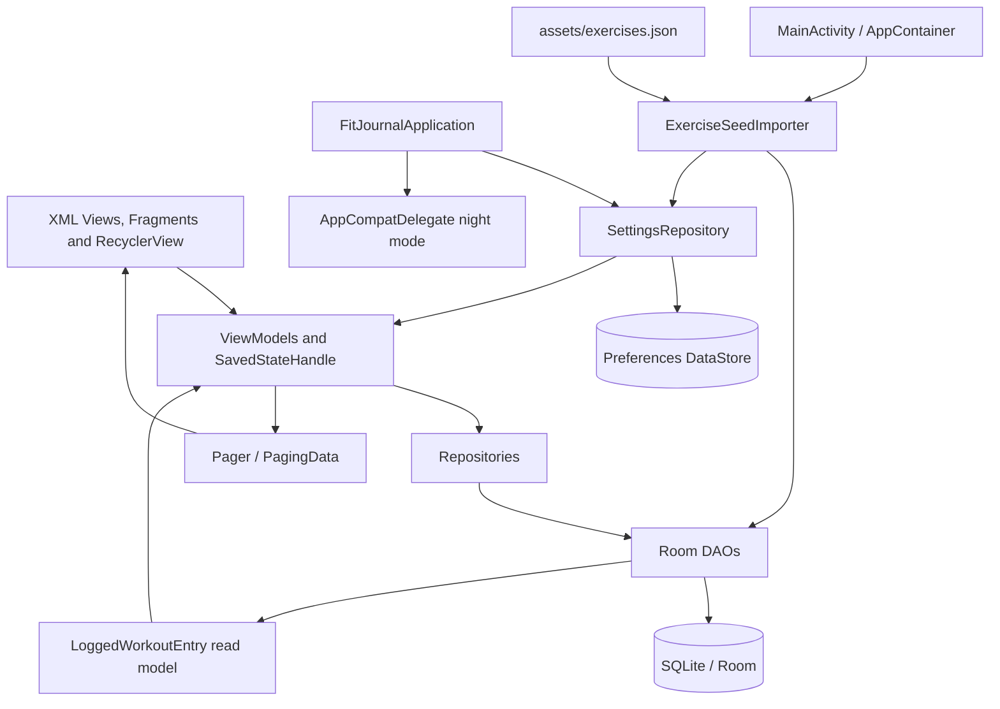
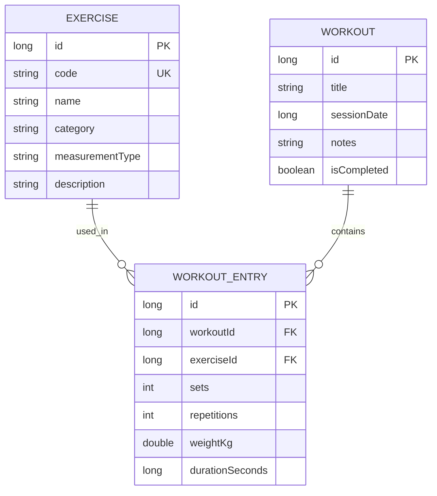

# FitJournal architecture

## Application and data flow

Room queries and preference changes emit Flows. Fragments collect them with `repeatOnLifecycle`; repositories provide the data boundary, while ViewModels hold UI state and perform operations in `viewModelScope`.

## Room schema

- The database is `FitJournalDatabase`, version 1. This completion work changes queries and validation, not the schema.
- Deleting a workout cascades to its entries.
- Deleting an exercise referenced by entries is restricted.
- Joined entry projections supply the current exercise name and tracking type without one lookup per row.

## Exercise catalogue and JSON initialization

- Search and the selected category are stored in `SavedStateHandle`.
- Categories come from the live exercise data, with case-insensitive deduplication. The DAO also matches selected categories without case sensitivity.
- Search, category, and the saved exercise order combine into the Paging 3 query. `collectLatest` replaces obsolete paging generations.
- The catalogue sort control updates the same persistent `exercise_sort` preference as Settings. There is no separate screen-only order.
- JSON loading runs on IO and parsing/validation runs away from the main thread.
- Import validates field types, the shared exercise rules, and at least 20 distinct valid seed codes before writing.
- All insertions share one Room transaction. The unique `code` index and conflict `IGNORE` preserve existing records and user edits during retries.
- A DataStore marker skips later imports. If the process stops after the Room commit but before the marker is written, retrying still cannot duplicate or overwrite existing codes.

## Workouts, logging, and progress

- Workout dates represent the local start of the chosen day; `WorkoutDates` handles date-picker and time-zone conversions.
- Workout and entry drafts use `SavedStateHandle`.
- Entry forms validate strength and duration metrics separately.
- Weights are stored as kilograms and converted to the selected unit only at UI boundaries.
- Progress combines live workout and joined-entry Flows. Counts, volume, chart, and records include completed workouts only.
- Strength volume is `sets × repetitions × weightKg`; timed entries do not contribute.
- Personal records use maximum weight for strength and longest duration for timed exercises.

## Preferences and navigation

- `dark_mode`: Boolean, absent means follow the device theme.
- `weight_unit`: `kg` or `lb`.
- `exercise_sort`: `NAME_ASC` or `NAME_DESC`.
- Preferences use DataStore. Setters validate supported values and unknown stored values fall back to defaults.
- `FitJournalApplication` applies the theme before the first activity and observes later changes. Activity recreation preserves form drafts.
- Navigation uses four top-level tabs and three child destinations.
- The shared `MainActivity` shell manages back navigation, system-bar/cutout/IME insets, and bottom navigation visibility.

## Verification

Unit tests exercise validators, calculations, preferences, form state, and catalogue query state. Instrumentation tests exercise the real Room queries and constraints in an in-memory database, importer retry safety with isolated DataStores, and the user workflows through Espresso.

For clean-install checks, the optional Gradle property `-Pfitjournal.isolatedValidation=true` installs the debug app as `com.fitjournal.app.validation`. The standard app remains `com.fitjournal.app`; its existing database and preferences are not cleared.
